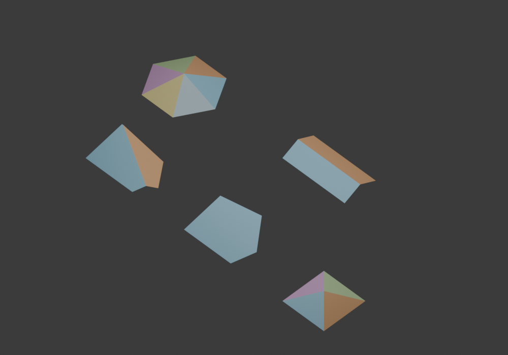

# Boundary-conditioned roof kernel

Status: full-Line source-wavefront implementation with certified arithmetic,
concave mixed-role construction and independent mesh proofs. The distributed
1.5.0 generator remains the checkpoint. The current implementation, wall-profile
distinction and remaining universal/migration obligations are in
[LINE_KERNEL_IMPLEMENTATION.md](LINE_KERNEL_IMPLEMENTATION.md). Finite corpus
success is not an unconditional completeness theorem or an addon promotion.

## Objective and authority

```text
closed source-labelled BoundaryPath
  -> explicit EAVE / GABLE intervals (RoofIntent)
  -> one global boundary-conditioned wavefront
  -> RoofComplex with event coordinates, times and source patches
  -> validation
  -> mesh discretization
  -> Blender
```

Rectangle, receiver and symmetry analysis may suggest intent. They must not decide
whether the kernel can construct a roof. A gable is declared before propagation;
it is not a triangular face discovered in an ordinary skeleton. There is no
terminal, parallel-support or shape-name predicate in the target kernel domain.
An ordinary all-eave skeleton is one instance of this model, not a fallback for a
failed gable request. No new cap/junction exceptions will be added to 1.5.0 as part
of this work.

## The existence condition needs correction

A simple footprint with at least one eave is **not** enough to guarantee the
requested roof under the proposed constant-pitch, no-additional-source model.

Use the CCW polygon

```text
(0,0), (8,0), (8,3), (3,3), (3,8), (0,8).
```

Declare only edge 3, `(3,3) -> (3,8)`, an eave, with all other edges gables.
This is a valid simple straight footprint. Its sole inward eave normal is
`(-1,0)`. With unit run-time and pitch `p > 0`, every inclined patch must lie on

```text
z = h + p * (3 - x).
```

The interior point `(6,1)` would have height `h - 3*p`. Thus a terrain covering
the footprint, staying above the common eave height, made only from this source
plane cannot exist. Vertical gable walls cannot cover an open projected region.
More event handlers, a seed or a nonlinear solve cannot correct this contradiction.
Introducing another source or changing the intent would change the input model.

For any input, a necessary condition is that the union of the nonnegative inward
half-planes of the declared eaves covers the footprint interior. This is only a
necessary test; it is not asserted to certify global wavefront completion. A
kernel implementation must not call every case that it cannot solve "invalid
intent". It needs a mathematical impossibility witness to make that diagnosis.

For a bounded convex straight polygon, at least one full-edge eave **is** sufficient:
all inward distances are nonnegative throughout the polygon. If `E` is the set of
eaves, its remaining wavefront region is

```text
W(t) = P intersect { d_e(x) >= t for all e in E }.
H(x) = min { d_e(x) : e in E }.
z(x) = h + p * H(x).
```

The regions are nested and disappear in finite time. The height is continuous,
nonnegative and piecewise affine. Each projected patch has an eave source. This
is a useful independent closed-form proof domain; it is **not** a formula for
concave straight skeletons and must not be extended to them by a plane envelope.

An all-eave simple straight polygon has the classical inward-wavefront definition.
The current bundled implementation's event exception is an implementation failure
on that domain, not proof that the roof does not exist.

## Boundary and intent representation

BoundaryPath owns an ordered closed path of source primitives. Initially the
implemented geometric primitive is Line. The contract reserves CircularArc and
parametric Curve as different geometric sources, without pretending they can
already be propagated by the line engine.

Each source has a stable caller-supplied identity and its own parameter range.
RoofIntent partitions that range into disjoint, covering EAVE/GABLE intervals.
Splitting an interval for predicates or mesh sampling retains its source identity
and parameters. Incidental sample or vertex numbering is not an architectural ID.
Winding reversal reverses the interval parameters and physical inward normals.
Collinear vertices with the same role may be computationally coalesced; a role
transition must never be erased by polygon normalization.

Full-edge intent is the first proof input. A collinear EAVE/GABLE transition has
adjacent supports with different speeds: their offset lines separate immediately
and have no intersection. The model must specify the connector/boundary evolution
at time zero before accepting arbitrary partial intervals. A guessed tiny edge,
coordinate perturbation or undeclared source plane is not that specification.
This is a missing model decision, not a reason to quietly map partial intent to
a whole-edge gable. Arc and Curve roles also retain exact parameter intervals.

## Kinematics and RoofComplex

Normalize units once and retain the inverse physical frame. For a CCW Line source
with inward unit normal `n` and `c = dot(n, a)`, its active support is

```text
dot(n, x(t)) = c + speed * t
speed(EAVE) = 1
speed(GABLE) = 0
z(t) = eave_height + pitch * t
```

The inclined patch of an eave therefore has the exact equation
`z = eave_height + pitch * (dot(n,x) - c)`. A gable contributes boundary/wall
incidence, not an inclined roof patch. Adjacent support equations determine
vertex trajectories where their intersection is defined. The kernel records
those trajectories and collision times; it does not seek coordinates with a
generic nonlinear optimizer after deciding topology.

RoofComplex is the authority for:

- vertices with spatial position and event time;
- oriented patch boundaries and source primitive/interval identity;
- shared crease incidence and boundary traces;
- event clusters, with all participating active fragments;
- separate wall patches, where the boundary evolution generates them.

For Line eaves, roof patches are planar. RoofGraph is a validated indexed planar
view of that complex, with the same shared vertices and patch incidence. Walls
are not inserted as positive-projection RoofFaces. Curve patches eventually have
their own surface evaluation and error-bounded tessellation, rather than acquiring
one semantic roof face per sampled chord. Mesh conversion may not repair topology,
invent faces, replace intent or alter a source patch to make a validator pass.

## Events and numeric contract

The kernel needs active fragments with source lineage and oriented adjacency, not
a list of independently generated building parts. Edge collapse, reflex contact,
coincident endpoints and collinear overlap are changes to this one state.

1. Predict certificates for the current state and find the earliest event time.
2. Resolve overlapping time uncertainty before deciding which events coincide.
3. Collect the entire time cluster. Distinct spatial contacts at that time remain
   distinct components inside the cluster.
4. Build the contact incidence before changing any participant. Resolve affected
   components together, including zero-time events exposed by that change.
5. Finalize swept patches; invalidate old certificates; continue only with a
   closed, correctly oriented front. A collapsed segment is a ridge trace, not
   a surviving zero-area polygon.

This is a required implementation contract, not an assertion that a particular
unimplemented contact pairing works. Kinetic triangulation is a researched
candidate for state/certificate management; an event queue alone is insufficient.
Candidate priority or dictionary order must not choose an arbitrary post-event
pairing. Shared events are not split into fixture-specific templates.

Filtered floating-point predicates need a precision escalation path for uncertain
signs/times. With Euclidean unit normals even rational line input leads to square
roots; using Fraction only for the original coordinates does not make all event
predicates exact. No blanket epsilon merge, snapping a real angle, or perturbing
the footprint establishes robustness. Resource limits and cancellation are
separate execution outcomes. A bounded prefix is never a completed RoofComplex.

## Failure ownership

| Outcome | Evidence required | Interpretation |
| --- | --- | --- |
| Invalid boundary | self-intersection/touching, zero area/length, nonfinite geometry, broken primitive continuity | Input error |
| Inconsistent intent | incomplete/overlapping intervals or a proved nonexistence witness | Input/model error |
| Unspecified model | partial-transition/curve rule not yet defined | Development scope; do not claim the universal contract implemented |
| Kernel failure | valid admitted input, unresolved event or failed complex invariant | Bug/incomplete implementation, never normal UnsupportedRoofError |
| Incomplete execution | work/memory/precision limit or cancellation | Execution outcome; no mesh prefix |

The target guarantee is: **every mathematically admissible input in the published
kernel domain produces a validated complex, unless execution is incomplete**.
This domain cannot be defined as "whatever the current backend succeeds on".
Automatic intent generation must produce admitted intents by construction, or
expose the model ambiguity; it cannot silently substitute all-eave hip.

## Research and implementation reuse

| Primary source | Relevant mechanism / limitation | Mapping and decision |
| --- | --- | --- |
| [Held & Palfrader, 2017, sections 3.1–3.2, 4.1–4.3, Fig. 12](https://arxiv.org/html/1604.03362) | Finite delayed motion, vertical patches, non-elementary events; an edge that disappears before starting yields a gable without cap postprocessing. | Source speed schedule, event time and wall/roof separation. Permanent zero speed is not automatically covered by the finite-collapse premise; do not choose an arbitrary huge finite delay. |
| [Biedl et al., Weighted straight skeletons in the plane, sections 3–5](https://research-explorer.ista.ac.at/download/1584/5292) | Explicit weighted-event definition and degeneracies; the analyzed multiplicative model excludes zero weights. Negative weights can lose ordinary skeleton properties. | Keep only nonnegative speeds; treat zero-speed and parallel contacts as explicit obligations rather than importing a theorem for strictly positive weights. |
| [Huber & Held, 2011](https://www.sthu.org/research/publications/files/HuHe11.pdf) | Generalized motorcycle graph for PSLGs and global wavefront computation. | Global source lineage and degenerate-event research, not a ready stdlib Python weighted backend. |
| [Weiß, Jüttler & Aurenhammer, 2021, sections 2–4](https://www.ag.jku.at/pubs/2021wj.pdf) | Circular-arc offsets have vanish, terminal, contact and splice events; a splice requires a continuation convention. | Arc sources need an actual geometric evolution and curved patches. Retaining primitive IDs during tessellation alone does not implement this algorithm or prove weighted-gable correctness. |
| [Surfer2 source/build/license](https://github.com/cgalab/surfer2) | Triangulation-based CGAL/C++ implementation, GPLv3, native toolchain and arithmetic dependencies. | Strong event/arithmetic reference; candidate external proof backend. Windows builds and bundled Blender binaries would need validation; no native runtime dependency is added here. |
| [campskeleton source/build/license](https://github.com/twak/campskeleton) | Weighted Java engine, collision handling and per-edge machines; Apache-2.0, Maven/JVM dependencies. | Inspect complete same-height collision handling as a reference. A JVM adapter is not a stdlib Blender installation and its robustness must be tested, not presumed. |

No third-party algorithm source is copied. No new dependency or production fallback
is introduced. License/build information is not proof that a backend accepts all
zero-speed intents.

Concrete source inspection also distinguishes a cluster implementation from a
robustness guarantee. In campskeleton's
[HeightCollision.process](https://github.com/twak/campskeleton/blob/c5e88c9c7f1d0fb600e99efce43f60d47690f6a6/src/org/twak/camp/HeightCollision.java),
same-height collisions are grouped by location, chains are discovered and
validated before removals resume, then horizontal chains are processed. Spatial
grouping uses a fixed `0.01` distance, so this code cannot be assumed to meet the
proposed scale-independent predicate contract unchanged. It is useful researched
state handling, not a license to port its tolerances as certified predicates.
Surfer2 revision `c42f9a7f969cd661d060481cd3b8bac2bdfb8dfa` documents its CGAL/C++
build, including native arithmetic/library dependencies. Its weighted/zero-speed
domain and Windows distribution have not been verified here. Source-read receipts
are in [kernel/research-receipt.json](kernel/research-receipt.json).

## Acceptance and migration gates

The first independent proof uses arbitrary convex line paths with full-edge roles,
including nonparallel eaves and degree-four/six collision clusters. It checks the
kinematic equations and exact source/time incidence without using the 1.5.0 cap
generator or optimizer as an oracle. It is a proof domain, not a promotion gate by
itself.

The eventual line kernel must additionally pass all-eave and admitted mixed-role
concave inputs, simultaneous/reflex/overlap events, and frozen angled/nonuniform
grid corpora. Record boundary validity, intent admissibility, completed complex,
planar view, mesh and Blender separately. Random successes do not prove universal
coverage. Add independent invariants, fixed counterexamples and transformations.

Measure intent, certificates, cluster processing, complex extraction, validation
and mesh separately. Event-derived heights eliminate the existing complete-plane
solve for this model; SGA21 remains a separate graph-editing capability, not a
required postprocess of a complete wavefront roof. Optimizer removal must wait for
authority transfer, not be bundled into this research commit.

Do not switch the addon until a complete line-domain implementation and packaging
proof exist. Keep 1.5.0 as its checkpoint; do not extend its local cap grammar as a
substitute. Arc propagation follows only after the line model and event kernel
are established, with its own splice convention and approximation/error contract.

## Executed first proof

Start SHA: `65a90cbab75560b7f70a1f6c6e3e652835a2a744`.
Contract commit: `01dbe51`; independent construction commit: `1929e5d`.

[roof_kernel_proof.py](../roof_kernel_proof.py) is a development-only independent
oracle. It enumerates the vertices of the convex space-time body above by triples
of supporting constraints and extracts oriented inclined facets. A global time
cluster retains all contacts and all incident source IDs. It does **not** implement
an iterative event queue, reflex split or general contact rewrite. It uses bounded
floating-point algebra, not certified exact predicates. Its `O(n^4)` worst-case
enumeration is intended for small proofs and must not become the production kernel.

The original source path survives validation: no role transition is removed by
the current footprint analyzer. Full source identity/parameter range, EAVE/GABLE
role and event time are distinct data. Inclined patches alone enter the proof
mesh; stationary wall patches are not exported. All heights are event-derived,
without the ordinary skeleton, terminal-cap code or embedding solver.

The new five-edge nonparallel example is rejected by 1.5.0's automatic gable
selection (`no opposed-support terminal gable cap`). The explicitly declared
boundary proof produces two inclined facets, with nonconstant ridge height. This
compares construction capability, not identical architectural candidate policies:
1.5.0 has no equivalent explicit mixed boundary input API.

Independent tests exhaust all **498** nonempty eave subsets on convex 3–8-edge
paths. They check source-plane height, SVD planarity, positive normals, polygon
union, no interior overlap and event incidence. Square and regular hexagon
contacts preserve four/six incident source identities; rectangle contacts at the
same time remain two distinct locations. Source-aware winding/cyclic/rotation/
translation and repeated-run proofs pass. Budget exhaustion returns no prefix.
The concave single-eave counterexample has its own nonexistence certificate;
concave construction and partial collinear transitions are **outside this proof**,
not classified as mathematically invalid by a scope rejection.

The frozen [input records](../tests/fixtures/kernel_line_proofs_v1.json) yield
five completed convex construction proofs, one nonexistence witness and two
construction/model probes outside the convex oracle. The concave all-eave input
has a known classical roof: its owner is proof/construction scope, not invalid or
ambiguous intent. The collinear partial-role input instead has an unspecified
model rule. The report keeps this distinction explicitly. Local full suite:
**246 tests pass**.
Blender 4.3.2 turns all five proof complexes directly into editable meshes with
planarity, manifold disk, normal, UV, material and source-provenance checks. Face
cycles and vertex count stay unchanged; no mesh repair is used. These are
development proof meshes, **not new addon-supported cases**.

| Proof input | Vertices | Patches | Positive-time clusters | Median ms (9 warm samples) |
| --- | ---: | ---: | ---: | ---: |
| Nonparallel full gables | 7 | 2 | 3 | 0.571 |
| Convex single eave | 5 | 1 | 3 | 0.376 |
| Square, all eave | 5 | 4 | 1 | 0.392 |
| Hexagon, all eave | 7 | 6 | 1 | 0.794 |
| Rectangle, two opposite gables | 6 | 2 | 1 | 0.185 |

Exact counts and raw timing samples are in [kernel/report.json](kernel/report.json).
These tiny convex-oracle timings are neither production performance nor a
comparison to the existing generator's full candidate pipeline.

[Nonparallel boundary proof](kernel/00.svg) and
[nonexistence witness](kernel/05.svg) distinguish eaves (blue), gables (red) and
event contacts. The [Blender evidence](kernel/blender-report.json) corresponds to
the image below. Render positions are for display only.



```bash
python python/probe_roof_kernel.py --output python/out/kernel-proof
python -m unittest python.tests.test_roof_kernel_proof -v
python -m unittest discover -s python/tests
blender -b --factory-startup --python-exit-code 1 --python python/blender_kernel_proof.py -- --output python/out/kernel-proof/blender
python python/build_addon.py --check --output packages/roof_generator-1.5.0.zip
```

The full-Line implementation now covers concave mixed-role propagation,
simultaneous contact incidence, stationary-remnant certificates and precision
refinement. The next production gates are universal zero-speed/completion
obligations, a sufficient admissibility/automatic intent policy, and addon
authority transfer. Partial-interval closure and Arc evolution remain later model
work. The necessary half-plane condition is not substituted for a sufficient
admissibility criterion. Production remains at 1.5.0; no "nonparallel cap" patch
or solver-based rescue has been introduced.
