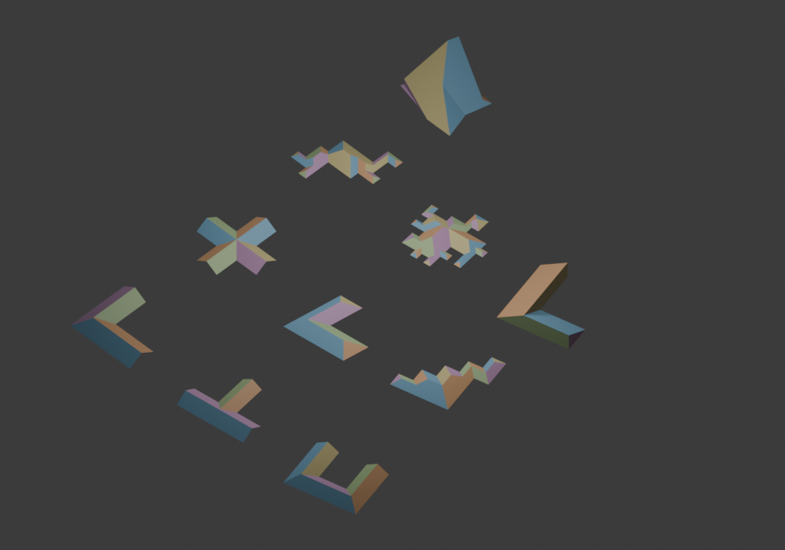

# Full-Line kernel evaluation

> Historical phase record frozen from document revision `62809e7` (inventory `62809e7`).
> Stop instructions, status and next-step statements below apply to that recorded phase.
> Current authority: [packaged release](../current/README.md), [kernel contract](../kernel/ROOF_KERNEL_CONTRACT.md);
> [index](../README.md) records successors and current adoption gates.

This is evaluation of the explicit boundary-conditioned kernel, not the packaged
addon's automatic gable coverage. Start SHA:
`f85af2ccf0ea9f846996f3325498fb4b5b0be79f`. Runtime construction, input snapshot,
export rounding and diagnostic changes are separated into reviewable commits.
Implementation and model conventions are in
[LINE_KERNEL_IMPLEMENTATION.md](../kernel/LINE_KERNEL_IMPLEMENTATION.md).

[Extracted implementation proof notes](LINE_KERNEL_PROOFS.md) preserve the
original `62809e7` independent-oracle and fixed-regression scope separately from
the live implementation specification.

## What is generated

The constructor receives the original source path and full-edge roles. It builds
source trajectories, predicts common-time contacts, nodes all fragments, resolves
coincident intervals and their cyclic links, closes newly exposed same-time
contacts, then extracts and validates the source patches. Collapse, component
split and higher-degree contacts use this one operation. Coordinates and heights
are event-derived; the ordinary skeleton, cap conversion, polygon Boolean and
embedding optimizer are not called.

Inclined patches and stationary walls are different parts of `RoofComplex`.
`mesh.view()` produces a roof-only surface only when every wall is exterior.
A complex that requires internal vertical steps is an explicit wall-inclusive
profile; silently omitting those faces is prohibited. These outcomes must not be
combined as one practical-roof support percentage.

## Frozen all-EAVE assignments

The input geometry is the existing separately categorized
[coverage_inputs_v1.json.gz](../evidence/inputs/corpora/coverage_inputs_v1.json.gz). Every edge is
explicitly declared EAVE for this test. This is not substitution after a failed
gable request.

| Corpus | Inputs | Exact complex | Float mesh | Independent validation |
| --- | ---: | ---: | ---: | ---: |
| Orthogonal connected-grid stress | 1000 | 1000 | 1000 | 1000 |
| Nonuniform orthogonal | 150 | 150 | 150 | 150 |
| Structured orthogonal | 103 | 103 | 103 | 103 |
| Convex quadrilateral | 48 | 48 | 48 | 48 |
| Structured oblique | 43 | 43 | 43 | 43 |
| General simple polygon probe | 40 | 40 | 40 | 40 |

[Summary](../evidence/results/line-kernel/all-eave-report.json) and
[per-input outcomes](../evidence/results/line-kernel/all-eave-cases.jsonl.gz) preserve stage counts,
work, predicates and individual inputs on failure. Grid stress is one category;
it is not overall project coverage. Blender has not been run over this entire
corpus.

## Frozen mixed roles

[kernel_mixed_inputs_v1.json.gz](../../tests/fixtures/kernel_mixed_inputs_v1.json.gz)
contains 720 specified assignments over the first 40 footprints in each of the
six families. They are three deterministic SHA-256 role assignments per input,
not 720 independent buildings and not an exhaustive gable-selection policy.
Production does not inspect these test names or use their role generator.

| Corpus | Assignments | Completed complex | Negative-plane witness | Stationary model remainder |
| --- | ---: | ---: | ---: | ---: |
| Orthogonal connected-grid stress | 120 | 90 | 4 | 26 |
| Nonuniform orthogonal | 120 | 95 | 4 | 21 |
| Structured orthogonal | 120 | 101 | 6 | 13 |
| Convex quadrilateral | 120 | 120 | 0 | 0 |
| Structured oblique | 120 | 98 | 6 | 16 |
| General simple polygon probe | 120 | 109 | 5 | 6 |

The 25 negative-plane witnesses prove an interior location cannot have a
nonnegative height on any declared EAVE plane. The 82 stationary remainders prove
noncompletion in the finite **causal active-source wavefront**: no moving source
remains and a positive-area stationary contour persists. This is a scoped model
certificate, not a claim that every arbitrary source-plane roof is impossible.
Their exact rational polygons and exact physical-unit event-time expressions
remain inspectable. Neither outcome is hidden by another intent, a seed or a hip
fallback.


| Corpus | Wall-inclusive mesh | Roof-only mesh | Internal walls required |
| --- | ---: | ---: | ---: |
| orthogonal_grid_stress | 90 | 3 | 87 |
| nonuniform_orthogonal | 95 | 3 | 92 |
| structured_orthogonal | 101 | 39 | 62 |
| convex_quadrilateral | 120 | 120 | 0 |
| structured_oblique | 98 | 48 | 50 |
| general_simple_polygon_probe | 109 | 48 | 61 |

The 613 completed complexes include **261 roof-only** surfaces and **352**
wall-inclusive outcomes. Random role assignments are not an architectural gable
producer. In particular, those 352 must not be reported as ordinary roof-surface
support. Independent validation succeeds for all 613 in the final run.

[Summary](../evidence/results/line-kernel/mixed-report.json) and
[per-assignment outcomes](../evidence/results/line-kernel/mixed-cases.jsonl.gz) also distinguish
wall-inclusive mesh from inclined-only mesh. The latter is the relevant profile
for an ordinary roof surface. Kernel failures and incomplete executions have
separate owners; no prefix is published as completed.

## Independent correctness evidence

- All 63 nonempty EAVE subsets on a concave six-edge boundary: 59 validated
  complexes, two negative-plane witnesses, two stationary model certificates.
- All 308 nonempty EAVE subsets on four convex rational paths with 3, 4, 5 and 8
  sides agree with the separate convex space-time oracle on every source region.
- A narrow connection actually changes one front component to two. A six-source
  collision stays one contact; a rectangular collapse has two spatial contacts
  at the same time.
- Two exact event times that round to the same double remain separate events.
- Exact rational rigid motion, winding, cyclic start, collinear subdivision,
  repeated generation and disabling endpoint/noding/root caches preserve semantics.
- Source equations, positive planar patch cycles, incidence, vertex links, Euler
  disk, one base boundary and full exterior interval provenance are checked in
  certified arithmetic. NumPy plane fitting and Shapely containment, pairwise
  intersection and total area provide independent numerical checks.

One frozen nonorthogonal step-wall case exposes a floating GEOS union failure:
raw union reports a 2.5416 area loss, while pairwise overlap is zero, total-area
error is `1.42e-14`, outside area is `4.91e-16`, and a `1e-12` precision overlay
agrees within `9.41e-12`. The oracle now uses the equivalent containment +
nonoverlap + equal-area proof and keeps raw union error as a diagnostic. Production
vertices are not snapped or altered. The regression input is
[kernel_projected_walls.json](../../tests/fixtures/kernel_projected_walls.json).

Exact source equations also certify removal of unnecessary degree-two section
vertices. The regression
[kernel_float_sections.json](../../tests/fixtures/kernel_float_sections.json)
keeps every real contact and removes only vertices on the same crease. Mesh
conversion checks floating representability; export rounding is isolated by
intervals, with exact midpoint decisions including ties-to-even.

## Blender evidence

Blender 4.3.2 reads ten completed complexes directly, without an addon or repair.
Eight are inclined-only roof meshes; two explicitly include required walls.
The final local suite passes **268 tests**.
The frozen examples cover L/T/U full gables, four terminal ports, an oblique
outline, Grid14/20/40, and two wall-inclusive step complexes. They check actual
object creation, vertex sharing, manifold disk, planarity, positive inclined
normals, UV unwrapping, materials and source provenance. Stored polygon cycles
and vertex count remain identical after UV operations.

[Machine report](../evidence/results/line-kernel/blender-report.json),
[SVG/JSON/OBJ cases](../evidence/results/line-kernel/report.json) and CI's `blender-addon-evidence`
artifact allow inspection. The smoke saves `complexes.blend`; source `.blend`
files are build artifacts rather than repository inputs.



[U](../evidence/results/line-kernel/orthogonal_U.svg), [four ports](../evidence/results/line-kernel/four_terminal_ports.svg),
[Grid20](../evidence/results/line-kernel/grid_20.svg), [Grid40](../evidence/results/line-kernel/grid_40.svg) and
[internal step](../evidence/results/line-kernel/internal_stationary_step.svg) distinguish declared
EAVEs/GABLEs, source patches, stationary traces and contact nodes. Display scale
and object rotation do not influence construction.

## Performance

The kernel has no nonlinear solve stage. These numbers measure one explicit
intent, not the addon's complete architectural candidate search. They are
unprofiled warm construction samples, with mesh conversion measured separately.
Instrumented exclusive stages and cProfile are separate observations.

[Before](../evidence/results/line-kernel/timing-before.json) and
[after](../evidence/results/line-kernel/timing-after.json) preserve raw samples and complex signatures.
The optimization removes avoidable rational allocation/canonicalization and
repeated immutable endpoint registration. No source family, geometry candidate
or validation condition is pruned. Cache-disabled construction remains equivalent.


| Input | Before construction ms | After construction ms | Mesh ms |
| --- | ---: | ---: | ---: |
| orthogonal_L | 45.60 | 36.68 | 1.99 |
| orthogonal_T | 73.25 | 42.67 | 2.18 |
| orthogonal_U | 140.42 | 85.24 | 3.81 |
| four_terminal_ports | 124.39 | 116.53 | 4.31 |
| nearly_collinear_event_sections | 649.54 | 286.63 | 4.19 |
| grid_14 | 167.84 | 80.89 | 2.14 |
| grid_20 | 323.82 | 152.85 | 3.27 |
| grid_40 | 835.89 | 481.74 | 6.60 |
| internal_stationary_step | 26.78 | 43.70 | 1.40 |

Before used five warm samples, after used nine; raw arrays are retained. Small
cases are susceptible to local scheduling noise, so this is not a claimed speed
contract. Complex signatures match for the nine paired cases. The timing snapshot
precedes the export-rounding correction; construction semantics do not depend on
export, and current conversion correctness is separately regression-tested.

Single-digit milliseconds are **not achieved**. Exact arithmetic, contact
noding and validation remain significant. Profile those costs before changing
representation; the old optimizer's seconds are not the new kernel's budget.
Detailed stage values are in the timing files. [cProfile](../evidence/results/line-kernel/profile-after.txt)
still attributes most work to split/noding and swept strips, rational scalar
operations, contact prediction and complete validation. The 40-corner unprofiled
construction median is about 482 ms, not a single-digit result.

## Current limits and next gate

No unconditional universal-completeness theorem is claimed from these finite
corpora. A sufficient independent admissibility policy, zero-speed contact
exhaustiveness and the automatic architectural intent producer remain production
adoption obligations. Wall-inclusive validity must not be advertised as a
continuous inclined-only roof.

The addon remains 1.5.0; its ZIP is unchanged and packaging regression is checked.
No runtime dependency or fallback is added. Partial collinear EAVE/GABLE
transitions still need a boundary-evolution definition. Arc propagation and
curved source surfaces follow that Line gate; chord sampling is not implemented
as a substitute. SGA21 remains an independent graph-editing capability.

Reproduce:

```bash
python -m unittest discover -s python/tests
python python/audit_line_kernel.py --oracle --output python/out/all-eave.json
python python/audit_line_kernel.py --corpus python/tests/fixtures/kernel_mixed_inputs_v1.json.gz --oracle --output python/out/mixed.json
python python/probe_line_kernel.py --convex-roles --output python/out/line-inspection
python python/benchmark_line_kernel.py --samples 9 --profile --output python/out/line-timing.json
blender -b --factory-startup --python-exit-code 1 --python python/blender_line_kernel.py -- --output python/out/line-blender
python python/build_addon.py --check --output packages/roof_generator-1.5.0.zip
```
